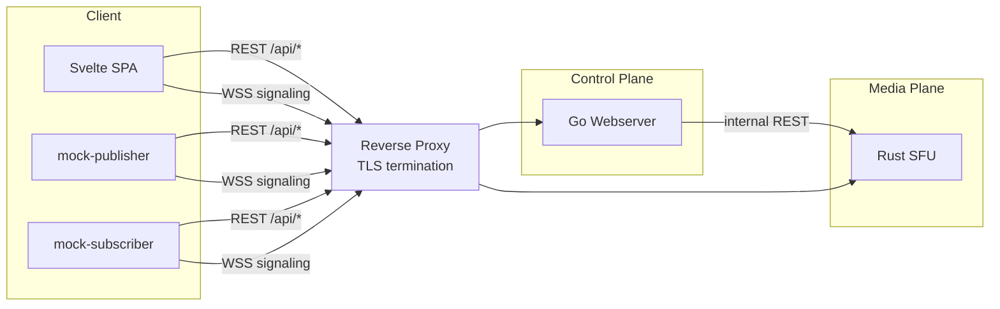
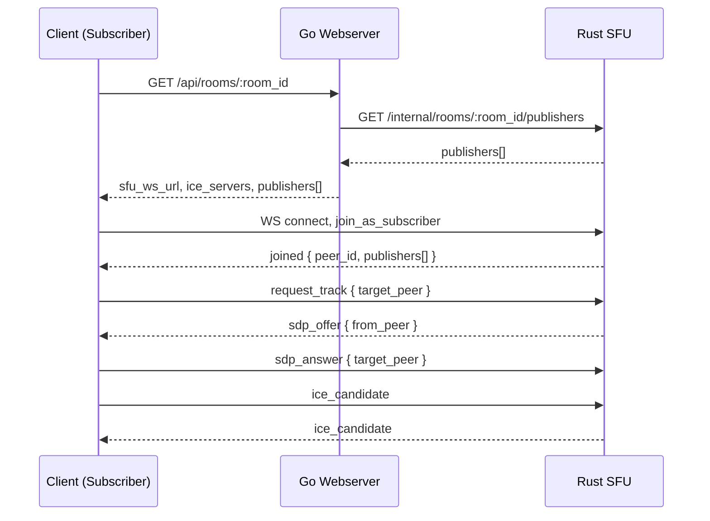

# Technical Architecture — Local Live Video Sharing

## 1. Overview

The system lets one or more **publishers** share a local video stream into a room, and one or more **subscribers** watch any of the active publishers in that room. It's split into three deployable pieces:

- **Svelte SPA** — the actual publisher/subscriber webapp, static assets served behind the reverse proxy.
- **Go webserver** — control plane: room lifecycle and admin auth, streamer registry, stage layout, IP blacklist, live updates over SSE, and hands clients the SFU's connection info. Public REST API.
- **Rust SFU** — media plane: WebRTC signaling and media relay. Public WebSocket, plus an internal REST API only Go can reach.

Two auxiliary Rust CLI apps (**mock-publisher**, **mock-subscriber**) exercise the same public contracts as the SPA, for testing the pipeline without a browser.

Everything sits behind a **reverse proxy** (nginx/traefik) which owns TLS termination and routes `/api/*` to Go and the websocket path to the SFU.

## 2. High-Level Architecture

**Why split control plane from media plane:** discovering "who's publishing in this room" needs a real query surface once there's more than one publisher — a single in-process `mpsc` channel (the original design) only works if webserver and SFU are the same binary. Separating them costs a network hop, but mirrors how production SFU systems are structured and leaves room to run multiple SFU instances behind Go later without changing the public contract.

## 3. Component Responsibilities

### 3.1 Svelte SPA
- Lets a user create a room (with the server passcode) or pick a room and a role (publish or watch) before connecting to anything. The admin token from room creation is kept in `localStorage`.
- Calls Go's room endpoint to learn the current publisher list, the SFU's websocket URL, and ICE server config.
- Opens a websocket directly to the SFU and drives WebRTC negotiation (`RTCPeerConnection`, `getUserMedia` for publishers, `<video>` elements for subscribers).
- Keeps one SSE (`EventSource`) stream open to Go for stage updates and `room_closed`, and draws the stage templates.

### 3.2 Go Webserver (control plane)
- Public REST API (Section 4.1): room creation and closing, discovery, admin reclaim, streamers, stage layout, SSE events and the IP blacklist.
- **Owns room state, in memory:** the one open room, its admin token's `room_id`/creator IP, the streamer registry, the stage layout and the blacklist. All of it is gone when the Go process restarts.
- **Auth:** creating a room needs the server passcode (`.env`). Admin actions need the `admin_token` JWT (`admin: true`, `room_id`) in `X-Admin-Token`. The server stores no tokens.
- Internally queries the SFU (Section 4.2) rather than tracking media state itself — the SFU is the single source of truth for who's actually connected. While an `events` stream is open it polls the SFU's publisher list every 2 s to mark streamers live/offline.
- Enforces the blacklist (403 `blacklisted` on `GET /api/rooms/:room_id`) and, when an admin blocks someone, asks the SFU to disconnect that peer.
- No media or signaling logic — it never touches SDP/ICE payloads, only peer-id lists and connection metadata.
- Natural home for future concerns that don't belong in the SFU: multi-SFU routing, further room metadata.

### 3.3 Rust SFU (media plane)
- Owns all real-time room/peer state (who's publishing, who's subscribing, to whom).
- Serves the public signaling websocket directly (no intermediary process — this replaces the earlier "webserver forwards to sfu via mpsc" design, since there's no longer a same-process webserver in front of it).
- Serves a small **internal-only** REST API for Go to query room/publisher state, stats and peer IPs, and to close a room or disconnect a peer.
- Relays/negotiates WebRTC per pair: one `RTCPeerConnection` between the SFU and each publisher, and one between the SFU and each (subscriber, publisher) pair being watched.
- Forwards simulcast layers (`h`/`m`/`l`) per subscriber↔publisher pairing, stepping a pairing down from the subscriber's `connection_stats`. It never transcodes and a layer switch never renegotiates.
- Doesn't know which rooms Go created, so it never enforces room existence or the blacklist itself (see Section 8).

### 3.4 mock-publisher / mock-subscriber
- Rust CLI binaries that speak the exact same contracts as the SPA: hit Go's discovery endpoint first, then connect to the SFU's websocket.
- `mock-publisher` reads a local video file and publishes it into a room.
- `mock-subscriber` requests a publisher's track and writes received media into a local folder.
- Exist to exercise the webserver+SFU pipeline without needing a browser.

### 3.5 Reverse Proxy
- Terminates TLS (`wss://` for the SFU, `https://` for Go/static assets).
- Routes by path/host to Go vs. the SFU; the SPA and mock apps never need to know the real backend addresses, just the public-facing ones.

## 4. Communication Boundaries & Protocols

### 4.1 Client → Go (public REST)

Admin endpoints need `X-Admin-Token`. Errors share one body shape with a machine-readable `code`; endpoints that need the SFU answer 502 `sfu_unreachable` when it's down.

| Endpoint | Auth | Purpose |
|---|---|---|
| `POST /api/rooms` | passcode in body | Creates the server's single room; returns `room_id` and `admin_token`. 409 `room_exists` if one is already open, 403 `invalid_passcode` if the passcode is wrong. |
| `GET /api/rooms/:room_id` | — | Room snapshot: publisher list, `sfu_ws_url`, `ice_servers`. 404 if the room was never created or has been closed; 403 `blacklisted` for a blocked IP. A created-but-empty room is a normal 200. |
| `GET /api/rooms/:room_id/publishers` | — | Just the publisher list, for cheap polling. |
| `DELETE /api/rooms/:room_id` | admin | Closes the room via the SFU; sends `room_closed` on SSE. |
| `POST /api/rooms/:room_id/admin/reclaim` | creator IP | Re-issues the admin token to the IP that created the room. |
| `PUT /api/rooms/:room_id/streamers/:streamer_id` | — | Registers or updates a streamer (`peer_id`, `display_name`) after each SFU `joined`. |
| `GET /api/rooms/:room_id/stage` | — | Template, placements and every registered streamer with liveness. |
| `PUT /api/rooms/:room_id/stage` | admin | Replaces the template and all placements. |
| `GET /api/rooms/:room_id/events` | — | SSE stream: `stage_updated`, `room_closed`. |
| `POST /api/blacklist` | admin | Blocks the IP of a `peer_id` and disconnects that peer. |
| `GET /api/blacklist` | admin | Lists blocked IPs. |
| `DELETE /api/blacklist/:ip` | admin | Unblocks an IP. |
| `GET /api/health` | — | Liveness. |

### 4.2 Go → SFU (internal REST, not exposed past the reverse proxy)

| Endpoint | Purpose |
|---|---|
| `GET /internal/rooms/:room_id/publishers` | Backs the public discovery endpoint and streamer liveness. |
| `GET /internal/rooms/:room_id/stats` | Publisher/subscriber counts and subscriber quality counts. |
| `GET /internal/rooms/:room_id/peers/:peer_id` | The IP a connected peer opened its websocket from (via `X-Real-IP`); used to resolve a blacklist target. |
| `POST /internal/rooms/:room_id/peers/:peer_id/disconnect` | Disconnects one peer; called when the admin blocks it. |
| `POST /internal/rooms/:room_id/close` | Sends `room_closed` to everyone in the room, closes their connections and drops the room. |
| `GET /internal/health` | Liveness/readiness of the SFU process. |

Chosen as **synchronous request/response** rather than the SFU pushing events to Go: simpler to build and always accurate, at the cost of an extra hop per discovery call and a hard dependency on the SFU being reachable when Go needs it. Revisit only if this becomes a bottleneck.

### 4.3 Client ↔ SFU (public WebSocket signaling)

One websocket connection per client. Role (publisher/subscriber) is fixed for the lifetime of the connection, decided by which join message is sent first; a peer is never both.

**Key asymmetry:** a publisher has exactly one peer connection — with the SFU itself. A subscriber may have *multiple* concurrent peer connections, one per publisher it watches. Every subscriber-side message therefore carries `target_peer`; publisher-side messages don't need one (`target_peer: null` / omitted = "the SFU itself").

Client → Server: `join_as_publisher`, `join_as_subscriber`, `sdp_offer`, `sdp_answer`, `ice_candidate`, `request_track`, `connection_stats`, `set_preferred_layer`, `leave`.

Server → Client: `joined` (includes assigned `peer_id`, `ice_servers`, and the current publisher snapshot), `publisher_joined`, `publisher_left`, `sdp_offer`, `sdp_answer`, `ice_candidate`, `connection_quality`, `room_closed`, `error`.

Full message shapes are in [`API-Contract.md`](./API-Contract.md); this doc covers the structural decisions, not every field.

## 5. Negotiation Roles (perfect-negotiation pattern)

- **Publisher ↔ SFU:** publisher is always **impolite** (always the offerer, including for renegotiation — e.g. adding a screen-share track later reuses the same `sdp_offer`/`sdp_answer` messages, no new message type). SFU is **polite** on this pairing, i.e. it would defer to the publisher's offer if a glare ever occurred.
- **Subscriber ↔ SFU (per publisher):** strictly one-directional — SFU is always the offerer, subscriber always the answerer, triggered by the subscriber's `request_track`. Since the subscriber never sends an unsolicited offer, there's no glare case to resolve on this pairing at all.

## 6. Room & Peer Lifecycle

0. The admin calls `POST /api/rooms` with the server passcode → gets `room_id` and `admin_token`. Everyone else gets the `room_id` from the QR code or manual entry.
1. Client calls `GET /api/rooms/:room_id` on Go → gets `sfu_ws_url`, `ice_servers`, current publisher list (404 if the room doesn't exist, 403 if the IP is blacklisted). It also opens `GET /api/rooms/:room_id/events` for stage updates.
2. Client opens websocket to the SFU, sends `join_as_publisher` or `join_as_subscriber`.
3. SFU assigns `peer_id`, replies with `joined`. A publisher then registers with Go via `PUT /api/rooms/:room_id/streamers/:streamer_id`.
4. **Publisher path:** publisher sends `sdp_offer` (`target_peer: null`) → SFU answers → ICE trickles both ways → SFU broadcasts `publisher_joined` to subscribers in that room.
5. **Subscriber path:** for each publisher of interest, subscriber sends `request_track { target_peer }` → SFU sends `sdp_offer { from_peer }` → subscriber answers → ICE trickles both ways. The subscriber then reports `connection_stats`; the SFU may step the layer down and tells it with `connection_quality`.
6. On disconnect: if the peer was a publisher, SFU broadcasts `publisher_left` to that room's subscribers and tears down its `RTCPeerConnection`(s); if a subscriber, SFU just tears down its own connection(s). A publisher's streamer stays registered but goes not live.
7. **Closing:** `DELETE /api/rooms/:room_id` → Go asks the SFU to close the room → SFU sends `room_closed` to every peer and disconnects them → Go sends `room_closed` on SSE and drops the room's state.

## 7. Key Design Decisions & Rationale

| Decision | Rationale |
|---|---|
| Control plane (Go) separate from media plane (Rust SFU) | Multi-publisher discovery needs a real query surface; in-process `mpsc` only worked for a single-binary design. Also sets up a path to multiple SFU instances later. |
| Go↔SFU is synchronous REST, not event-pushed | Simpler to build, always accurate; accepted cost is one extra hop per discovery call. |
| Rooms must be created; unknown or closed rooms are 404 | One room per server, created by an admin with the passcode. "No publishers yet" in a created room is still a normal 200. Existence is enforced only in Go, so it steers the app flow and isn't a security boundary. |
| Stage layout, streamer registry and blacklist live in Go | The SFU stays media-only. A stable `streamer_id` (not the per-connection `peer_id`) keys the stage so a refresh doesn't lose a spot. Changes reach clients over SSE. |
| Admin auth is a stateless JWT (`admin`, `room_id`) | Go stores no tokens; the `room_id` claim stops reuse across rooms. Tokens don't expire until the room closes. |
| Simulcast, subscriber picks the layer, SFU steps down | The SFU only relays RTP and can't transcode. No automatic step up, and a layer switch never renegotiates. |
| Blocking an IP also disconnects the blocked peer | One admin action covers both "kick" and "block". Go resolves the peer's IP through the SFU, stores the block, then asks the SFU to disconnect the peer. |
| SFU assigns `peer_id` | The SFU is the only party that actually needs to track connection identity in real time. |
| `target_peer` only on subscriber-side messages | Reflects the real cardinality: one connection for a publisher, many for a subscriber. |
| Publisher impolite / SFU polite; subscriber pairing has no glare case | Standard WebRTC perfect-negotiation pattern, applied only where glare can actually occur. |

## 8. Open Items / Future Work

- **Blacklist bypass via the SFU** — Go enforces the blacklist on `GET /api/rooms/:room_id`, but a client that opens the SFU websocket directly can still join. Closing this needs Go to push the blocked list to the SFU.
- **Watchers can't be blocked** — only `peer_id`s the admin can see (publishers) can be blacklisted. Options: expose subscriber `peer_id`s in an admin-only view, or accept publisher-only blocking.
- **Admin token expiry** — tokens don't expire; add an `exp` claim if "until the room closes" is too long.
- **Multi-track per publisher** — `request_track` currently implies a single stream per publisher; camera + screen-share as separate tracks isn't modeled yet.
- **Multiple SFU instances** — Go's discovery response would need to include which SFU instance owns a given room; not needed at current scale.
- **TLS in local dev** — reverse proxy handles this in the deployed setup; local development story (self-signed certs, or plain `ws://` over localhost) not yet decided.

## 9. Superseded Design (for history)

An earlier iteration combined webserver + SFU into a single Rust binary, with an axum websocket handler forwarding to an internal SFU task over `tokio::sync::mpsc`. That skeleton is preserved in `video-share-skeleton.zip` for reference but no longer matches this architecture — it didn't have a way for a control plane to query room state, since everything lived inside one process. The `sfu`-internal module pattern (per-room, per-peer state) from that skeleton is still a reasonable starting point for the new SFU's internals; only the transport (serving WS directly instead of via a separate webserver module) needs to change.